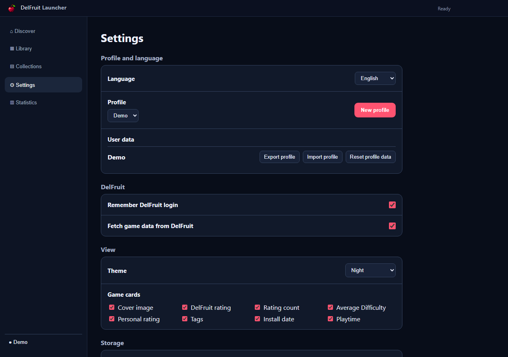

# DelFruit Launcher

A Windows desktop launcher for Delicious Fruit fangames. Browse the catalogue, install ZIP downloads or import existing game folders, and launch your games from a local library.

## Download

[Download the Windows installer from Releases](https://github.com/kayalareren/delfruit-launcher/releases). The installer lets you choose where ZIP downloads and installed games are stored.

## Screenshots

The screenshots use an example profile and library.




## Features

- Browse Delicious Fruit inside the launcher, install downloaded ZIPs, or import a folder of games.
- Track play time and launch counts, mark games complete, and add personal ratings, favourites, collections and custom covers.
- Fetch DelFruit ratings, difficulty, tags and screenshots on demand. The launcher can keep your DelFruit session and cache cover images locally.
- Use a mouse, keyboard or gamepad to navigate. Arrow keys move the virtual pointer, Enter clicks, and Page Up and Page Down scroll. With an Xbox layout, A clicks, B goes back in the browser, and Y reloads.
- Configure per-profile themes, languages, game controls and, for supported games, music and sound effects. Profiles can be backed up and restored.

Game executables come from their respective creators. The launcher does not bundle games.

## Build from source

Use Node.js 22 or later on Windows. The installer build uses the .NET Framework C# compiler included with Windows.

```powershell
npm ci
npx electron-builder --win nsis
```

The build creates `outputs/DelFruit-Launcher-v1.0.exe` and compiles the Windows input helper. After building the helper, you can also run the launcher from source with `npm start`.

## Credits

Made by **Labeletal**. Discord: `labeletal`.

DelFruit Launcher is an independent project. Delicious Fruit and the fangames it indexes belong to their respective creators.
