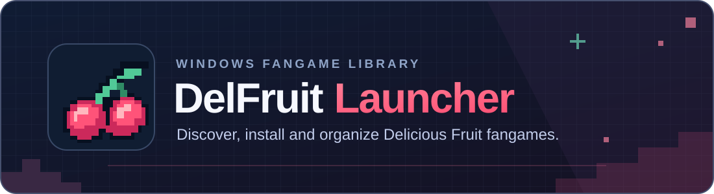
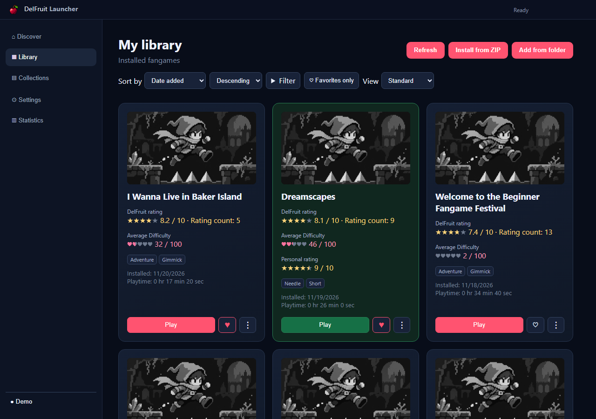

<p align="center">
  
</p>

<h1 align="center">DelFruit Launcher</h1>

<p align="center">A Windows desktop launcher for browsing Delicious Fruit, installing fangames, and keeping your collection organized.</p>

<p align="center">
  <a href="https://github.com/kayalareren/delfruit-launcher/releases/latest"></a>
  
  
</p>

<p align="center">
  <strong><a href="https://github.com/kayalareren/delfruit-launcher/releases/latest/download/DelFruit-Launcher-v1.0.exe">Download the Windows installer</a></strong>
  · <a href="#getting-started">Getting started</a>
  · <a href="#features">Features</a>
  · <a href="#screenshots">Screenshots</a>
</p>

## Getting started

1. Download and run **DelFruit-Launcher-v1.0.exe**. The installer lets you choose separate folders for ZIP downloads and installed games.
2. Create a local profile and choose your interface language. You can change either later in **Settings**.
3. Open **Discover** to browse Delicious Fruit. Download a game ZIP through the in-app browser, or use **Install from ZIP** to select a file you already have.
4. Open **Library** and select **Play**. Use **Add from folder** to import an existing game or a folder containing several games.

## Features

### Discover and install

| Feature | What it does |
| --- | --- |
| Built-in browser | Browse Delicious Fruit, open game pages and follow their download links without leaving the launcher. Open a page in your default browser when you need to. |
| ZIP installation | Install a downloaded ZIP from the browser or a local ZIP through the library. If an archive contains multiple executables, choose the one to launch. |
| Folder import | Import an existing game folder or scan a parent folder for games in its subfolders. Bulk imports can be grouped into a collection. |
| Separate storage | Choose where future downloads and installed games go. The original ZIP is kept separately from the extracted game. |

### Organize your library

- **Find games faster.** Filter by DelFruit tags, show favorites only, and change the card layout. Sort by date added, DelFruit rating, rating count, personal rating or launch count in either direction.
- **Make cards your own.** Choose which details to display, set a custom cover, mark a game complete, and rate it locally. Your personal rating is separate from its DelFruit rating.
- **Keep related games together.** Create named collections and add games to them from a card’s menu.
- **See what you play.** Track launches and total play time, check completion counts in **Statistics**, and restore previous play time when reinstalling a matching game.

### DelFruit data and local profiles

- **Refresh when you choose.** When a newly installed game has a linked DelFruit page, the launcher can fetch its rating, number of ratings, average difficulty, tags and first screenshot. **Refresh** updates linked games on demand. Cover images are cached locally.
- **Control the connection.** Toggle library data fetching and browser sign-in persistence independently in **Settings → DelFruit**.
- **Separate your preferences.** Create multiple local profiles and switch between them. Export, import or reset profile data from the settings page.
- **Customize the interface.** Choose a theme and one of ten interface languages: Turkish, English, German, French, Spanish, Portuguese, Russian, Japanese, Korean or Simplified Chinese.

### Keyboard, gamepad and game settings

| Action | Keyboard | Xbox layout |
| --- | --- | --- |
| Move the virtual pointer | Arrow keys | Left stick or D-pad |
| Click | Enter | A |
| Scroll | Page Up / Page Down, or move to a scrollable edge | Right stick, or move to a scrollable edge |
| Browser shortcuts | Use the toolbar | B goes back or returns focus to the sidebar on DelFruit’s home page. Y reloads. |

Remap movement, jump, shooting, restart, skip and pause for games using the expected defaults. Gamepad buttons can be mapped as well. You can also send **F4** on launch for games that use it for fullscreen, and set music and effects levels for games with a supported audio configuration.

## Screenshots

The screenshots show an example profile and library.

### Library



### Settings


## Build from source

On Windows, install Node.js 22 or later. The build uses the .NET Framework C# compiler included with Windows to compile the native input helper.

```powershell
git clone https://github.com/kayalareren/delfruit-launcher.git
cd delfruit-launcher
npm ci
npx electron-builder --win nsis
```

The installer is written to `outputs/DelFruit-Launcher-v1.0.exe`. After the helper has been built, you can launch the development copy with `npm start`.

## Credits

Made by **Labeletal**. Discord: `labeletal`.

DelFruit Launcher is an independent project. Game downloads come from their respective creators.
